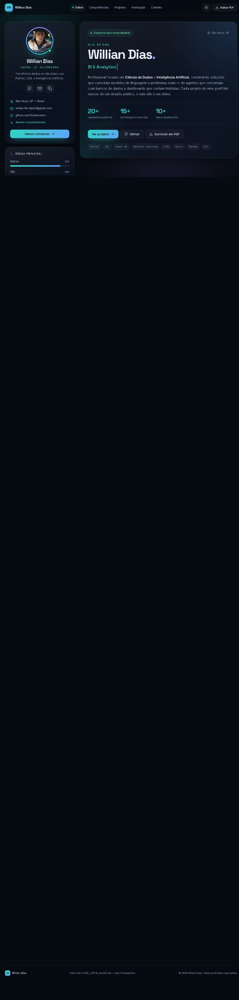

# Willian Dias — Portfólio & CV Online

> Currículo e portfólio pessoal construídos do zero com HTML, CSS e JavaScript — uma evolução do template disponibilizado pela [DIO](https://github.com/digitalinnovationone/cv).

[](https://developer.mozilla.org/pt-BR/docs/Web/HTML)
[](https://developer.mozilla.org/pt-BR/docs/Web/CSS)
[](https://developer.mozilla.org/pt-BR/docs/Web/JavaScript)
[](https://pages.github.com/)
[](https://www.dio.me/)

**Repositório:** privado (por enquanto). Quando você torná-lo público e ativar o GitHub Pages, o site ficará em `https://subaruberu.github.io/cv/`.

> **Nota:** este projeto está em um repositório privado. O GitHub Pages só publica sites de repositórios públicos no plano gratuito. As instruções de publicação estão mais abaixo.



---

## Sobre o projeto

Este repositório nasceu do desafio **“Construindo seu Currículo Online”** da DIO, mas foi além do template original: em vez de apenas replicar o layout em W3.CSS, o projeto foi reconstruído com **HTML semântico, CSS autoral e JavaScript puro**, incorporando boas práticas de acessibilidade, responsividade, SEO e performance.

O resultado é um site que funciona como **currículo, portfólio e cartão de visitas** — pronto para ser compartilhado em processos seletivos.

### O que evoluiu em relação ao template original

| Template DIO | Esta versão |
| --- | --- |
| W3.CSS + Font Awesome via CDN | CSS autoral com design system em variáveis |
| Tema único | Tema claro/escuro com preferência salva no navegador |
| Sem interatividade | Navegação ativa, animações de entrada, contadores e copiar e-mail |
| Apenas desktop | Layout responsivo (desktop, tablet e celular) |
| Acessibilidade limitada | Skip link, foco visível, ARIA e respeito a `prefers-reduced-motion` |
| Sem versão para impressão | Estilos `@media print` otimizados para gerar PDF |
| Conteúdo genérico | Conteúdo real: projetos, stack e formação |

---

## Funcionalidades

- **Tema claro/escuro** com detecção da preferência do sistema e persistência em `localStorage`.
- **Layout responsivo** em grid, com sidebar fixa no desktop e empilhada no mobile.
- **Navegação com scrollspy** — o link da seção visível é destacado automaticamente.
- **Animações de entrada** com `IntersectionObserver` (e desativadas para quem prefere menos movimento).
- **Barras de skill animadas**, contadores e rotador de áreas de atuação.
- **Botão “Copiar e-mail”** com feedback via toast e fallback para navegadores antigos.
- **Versão para impressão/PDF** — botão que prepara a página e abre a caixa de impressão.
- **SEO e compartilhamento** — meta tags Open Graph, favicon SVG e dados estruturados JSON-LD (`Person`).
- **Acessibilidade** — HTML semântico, skip link, `aria-*`, foco visível e contraste adequado.
- **Zero dependências de JavaScript** — apenas fontes do Google Fonts e ícones SVG inline.

---

## Tecnologias

- **HTML5 semântico** — `header`, `nav`, `main`, `aside`, `section`, `article`, `footer`.
- **CSS3** — custom properties, grid, flexbox, `color-mix`, `backdrop-filter`, animações e media queries.
- **JavaScript (ES5+)** — `IntersectionObserver`, `requestAnimationFrame`, `localStorage`, Clipboard API.
- **SVG sprite** — todos os ícones são inline, sem biblioteca externa.
- **Google Fonts** — Space Grotesk (títulos), Inter (texto) e JetBrains Mono (código).
- **GitHub Pages** — hospedagem estática gratuita.

---

## Estrutura do projeto

```text
cv/
├── index.html              # Página única com todas as seções
├── assets/
│   ├── css/
│   │   └── style.css       # Design system, layout, responsivo e impressão
│   ├── js/
│   │   └── main.js         # Tema, navegação, animações e interações
│   └── img/
│       ├── avatar.png      # Foto de perfil
│       ├── favicon.svg     # Favicon com monograma
│       └── preview.png     # Screenshot para o README
├── README.md
└── LICENSE
```

---

## Como rodar localmente

Não há build nem dependências. Basta servir a pasta como arquivos estáticos:

```bash
# Opção 1 — Python
python -m http.server 8000

# Opção 2 — Node.js
npx serve .

# Opção 3 — VS Code
# Instale a extensão "Live Server" e clique em "Go Live"
```

Depois acesse `http://localhost:8000`.

> Abrir o `index.html` diretamente com duplo clique também funciona, mas o botão de copiar e-mail pode exigir um servidor local por causa das permissões da Clipboard API.

---

## Como publicar no GitHub Pages

1. Crie um repositório público chamado `cv` no GitHub.
2. Envie os arquivos:

   ```bash
   git init
   git add .
   git commit -m "feat: portfólio e currículo online"
   git branch -M main
   git remote add origin https://github.com/Subaruberu/cv.git
   git push -u origin main
   ```

3. No repositório, acesse **Settings → Pages**.
4. Em **Build and deployment**, escolha **Deploy from a branch**.
5. Selecione a branch **main** e a pasta **/ (root)** e salve.
6. Em alguns minutos o site estará em `https://subaruberu.github.io/cv/`.

---

## Personalização

O conteúdo está centralizado no `index.html`. Para atualizar o currículo:

- [ ] Troque a foto em `assets/img/avatar.png` (quadrada, pelo menos 400 × 400 px).
- [ ] Atualize nome, cargo, localização e e-mail no topo e no rodapé.
- [ ] Ajuste as barras de skill em `.skill__bar[data-level]` e no texto de porcentagem.
- [ ] Adicione experiências profissionais na seção **Formação** ou crie uma seção **Experiência** seguindo o componente `.timeline`.
- [ ] Inclua o link do LinkedIn na sidebar (há um ícone pronto: `#i-linkedin`).
- [ ] Atualize os projetos e links conforme seu portfólio evoluir.
- [ ] Rode `git commit` + `git push` — o GitHub Pages atualiza automaticamente.

### Cores

As cores ficam no topo de `assets/css/style.css`, nos blocos `:root` (tema escuro) e `[data-theme="light"]` (tema claro). Basta alterar `--accent`, `--accent-2` e `--accent-3` para mudar a identidade visual.

---

## Acessibilidade e performance

- Contraste de texto validado para os dois temas.
- Navegação completa por teclado, com `:focus-visible` e skip link.
- `prefers-reduced-motion` desliga animações e transições.
- Ícones decorativos com `aria-hidden` e botões com rótulos acessíveis.
- Sem frameworks, sem build e sem JS de terceiros: apenas um CSS e um JS.
- Imagem de perfil com `width`, `height` e `loading="eager"` para evitar layout shift.

---

## Créditos

- Desafio original: [Digital Innovation One — cv](https://github.com/digitalinnovationone/cv).
- Referência de layout de currículo: [W3Schools — How To Create a Resume](https://www.w3schools.com/howto/howto_website_create_resume.asp).
- Ícones: SVG inspirados na [Lucide](https://lucide.dev/).
- Fontes: [Google Fonts](https://fonts.google.com/).

---

## Licença

Este projeto está sob a licença [MIT](LICENSE). Sinta-se livre para usar como base para o seu próprio currículo — só não esqueça de trocar os dados pessoais. 😉
